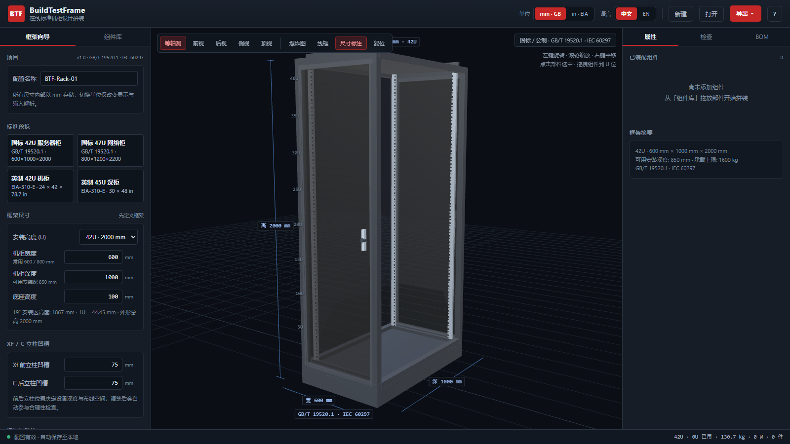
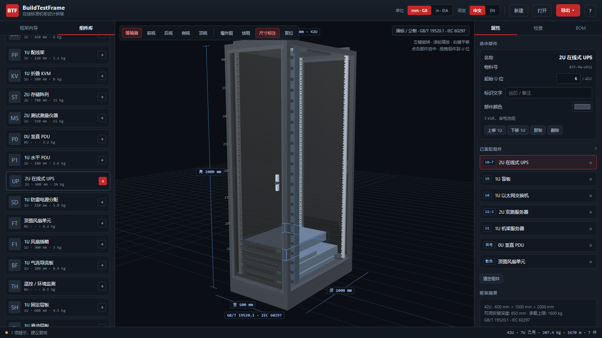
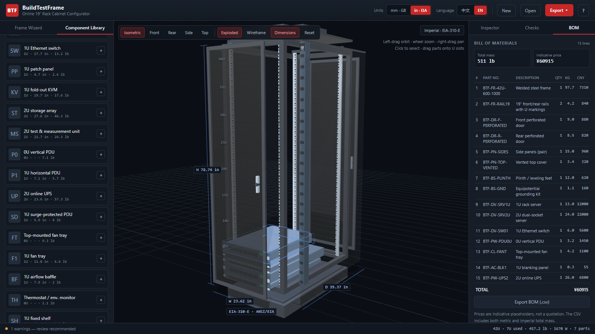
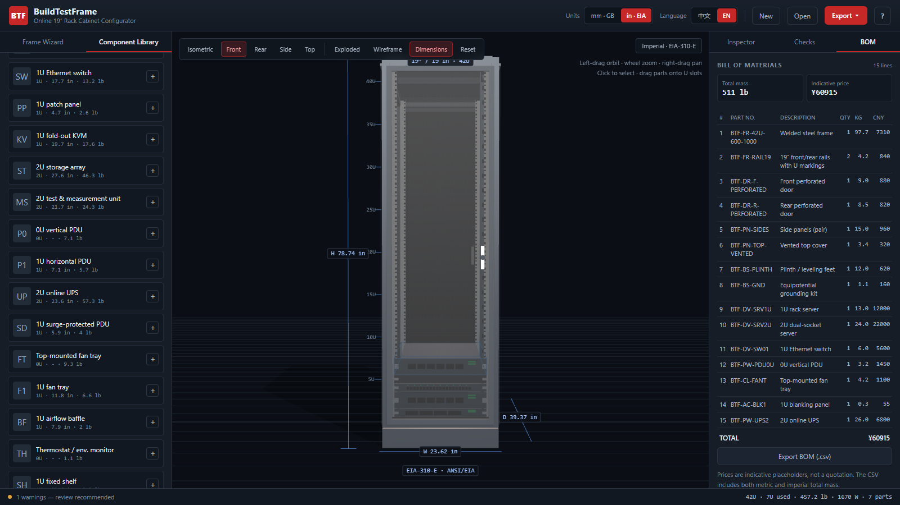
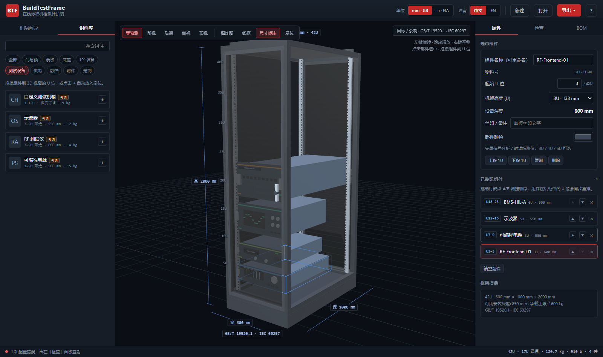
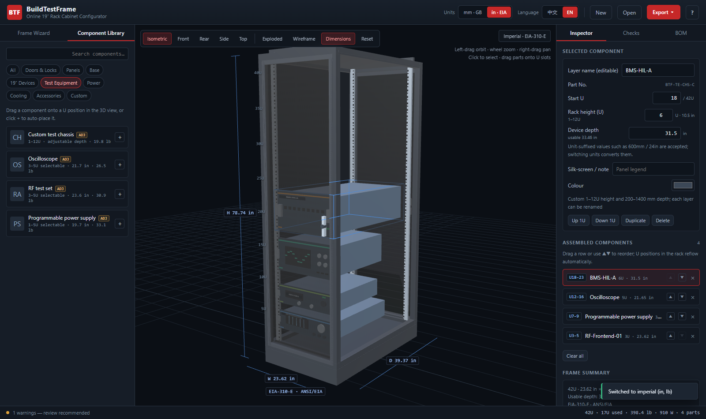
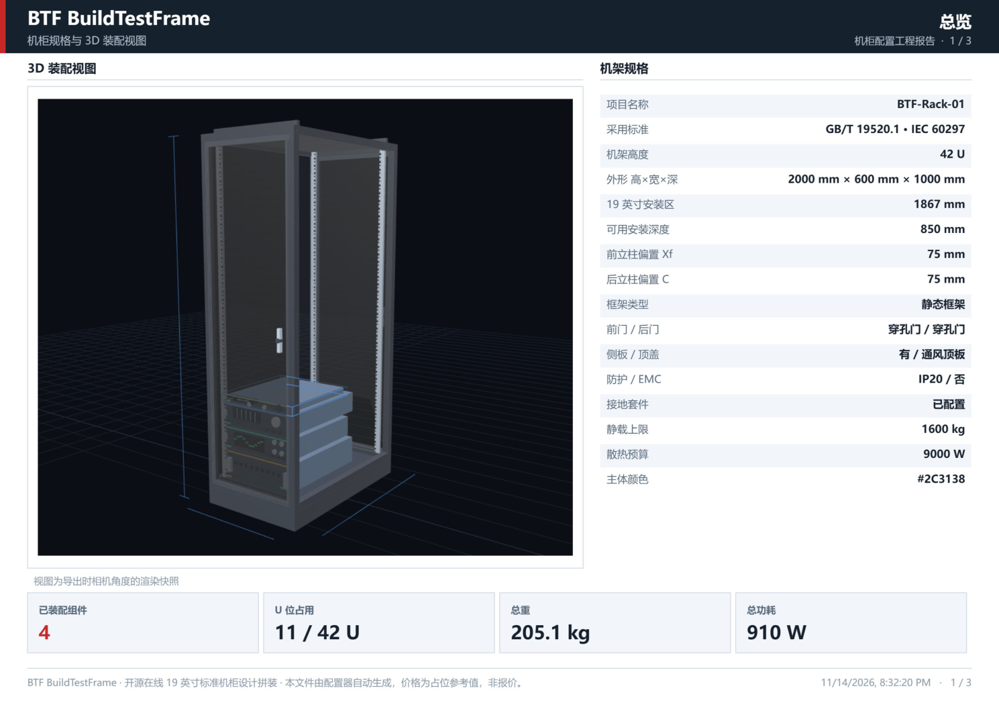
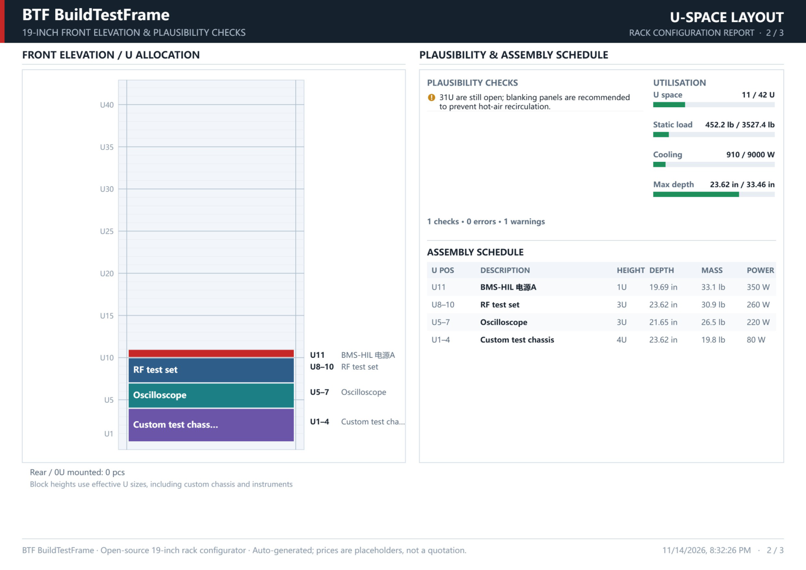
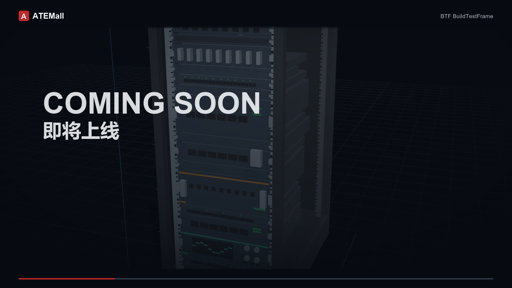
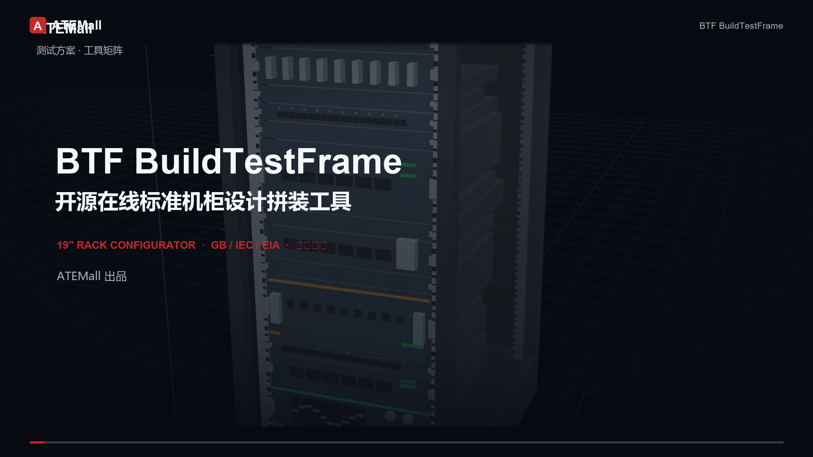

# BTF BuildTestFrame

开源在线 19″ 标准机柜设计拼装工具 · Open-source online 19″ rack cabinet configurator

[中文](#中文) | [English](#english)



---

<a id="中文"></a>

## 中文

### 这是什么

一个纯前端的机柜 3D 配置器：先用向导定义框架（高度 / 宽度 / 深度 / Xf-C 立柱凹槽），再拖放 19″ 组件到指定 U 位，实时生成参数化 3D 模型、合理性检查和物料清单。

功能与交互参考了 [nVent SCHROFF Varistar CP 3D 配置器](https://www.nvent.com/en-cn/schroff/configurator-overview-faqs) 的公开资料与登录引导页。**本项目为独立实现，未使用该站任何代码、图片、商标或产品数据，也与其无隶属关系。**

### 界面一览

| 框架向导（中文） | 装配后（中文） |
|---|---|
|  |  |

| 爆炸图 + BOM（英文） | 前视图（英文 / 英制） |
|---|---|
|  |  |

| 可配置测试设备（中文） | 组件库 + 属性（英文 / 英制） |
|---|---|
|  |  |

| PDF 工程报告（中文） | PDF 第 2 页（英文 / 英制） |
|---|---|
|  |  |

### 演示视频

| Coming Soon 预告片 | 完整功能介绍 |
|---|---|
|  |  |

- **预告片 19 秒**：ATEMall 即将推出在线测试机柜搭建工具，助力更高效地完成方案。
- **完整介绍 92 秒**：9 个章节覆盖框架向导、组件库 / 测试设备、逐层命名与排序、合理性检查、3D 检视、单位与双语、七种导出、开源许可。
- 成片 1920×1080 / 30fps / H.264 + AAC，中文字幕已烧录并附独立 SRT 时间码。MP4、字幕与分镜脚本文案随宣传素材包分发；因体积原因不纳入本仓库，此处仅保留封面。

### 功能对照

| 参考配置器 | 本实现 |
|---|---|
| 一系列对话框定义高度 / 宽度 / 深度，生成框架 | 「框架向导」参数化定义，3D 框架即时重建 |
| 拖放方式添加组件，组件库快速选件 | 45 个通用部件，HTML5 拖放到 3D 视图的 U 位；点击 `+` 自动找空位 |
| 按型号选配测试仪器与机箱 | 「测试设备」4 类可配置部件：U 高 / 深度按实例覆盖，改尺寸自动避让 U 位冲突 |
| 可信性 / 合理性检查 | U 位冲突、越界、设备深度、1600 kg 静载 / 1000 kg 动载、散热功耗、IP/EMC 与门型匹配、脚轮与接地缺件、空 U 位气流 |
| 色板即时预览 | RAL 色板 + 自定义取色，框架色 / 门色独立 |
| 开孔、文字、图片 / Logo 定制 | 定制开孔面板、文字丝印、Logo 铭牌，丝印文字可编辑 |
| 物料清单 BOM / 规格书 | BOM 面板 + CSV（含公制与英制总重）+ A3 多页 PDF 工程报告 |
| 2D/3D CAD 导出 | STL / GLB 网格 + STEP AP214 解析 B-rep 实体（`.stp`），可直接导入多数 CAD 软件 |
| 保存配置、作为新项目基线 | localStorage 自动保存 + JSON 配置导入 / 导出 |

额外能力：等轴测 / 前 / 后 / 侧 / 顶视图、爆炸图、线框模式、尺寸标注与 U 位刻度、部件拾取高亮、颜色与丝印编辑、上移下移 / 复制 / 删除。

**可配置测试设备**：自定义测试机箱（U 高 1–12U、深度 200–1400 mm 自由输入，支持 `600mm` / `24in`）、示波器与 RF 测试仪（3 / 4 / 5U 下拉可选）、可编程电源（1–5U 下拉可选）；4 类设备在 3D 前面板上带独立配色识别条。**每层组件可重命名**，名称同步到列表、BOM 规格与 3D 铭牌。**调整右侧「已装配组件」列表顺序即可挪动机柜内位置**：拖动行或点 ▲▼，U 位按新顺序自动重排并避让冲突；改 U 高 / 深度时同样自动找空位，空间不足会提示。

### 单位与标准

内部一律以 **mm / kg / W** 存储，切换单位只改变显示与输入解析，杜绝混用。

| 项目 | 国标 / 公制 | 英制 |
|---|---|---|
| 标准 | GB/T 19520.1、IEC 60297-3-100 | EIA-310-E |
| 1U | 44.45 mm | 1.75 in |
| 19″ 面板宽 | 482.6 mm | 19 in |
| 安装孔中心距 | 465 mm | 18.31 in |
| 常用宽度 | 600 / 800 mm | 24 / 30 in |
| 质量 | kg | lb |

输入框接受带单位文本：`600`、`600mm`、`24in`、`24"`、`2' 6"`、`0.6m`；不带单位时按当前单位体系解释。内置国标 42U / 47U 与英制 42U / 45U 预设，切换预设自动匹配单位体系。

### 快速开始

需要 Node.js 20+（本项目在 Node 22.22.2 上验证）。

```bash
npm install
npm run dev        # 开发服务器 http://localhost:5173
npm run build      # 类型检查 + 构建到 dist/
npm run preview    # 预览构建产物
```

`dist/` 是纯静态站点，可直接托管到 GitHub Pages、对象存储或任意静态服务器（`vite.config.ts` 已设 `base: './'`，子路径可用）。

### 使用流程

1. **框架向导**：选预设或自定义 U 数 / 宽 / 深 / Xf-C 凹槽 / 框架类型 / IP / EMC / 门型 / 颜色。
2. **组件库**：按分类筛选或搜索，拖到 3D 视图的目标 U 位；也可点 `+` 自动放到空位。
3. **属性**：重命名该层、修改起始 U 位 / U 高 / 深度 / 颜色 / 丝印；拖动列表行或点 ▲▼ 调整顺序（U 位自动重排），也可上移 / 下移 1U、复制、删除。
4. **检查**：实时查看错误与提示，点击条目可定位部件。
5. **BOM / 导出**：查看物料清单，导出 JSON / CSV / PNG / STL / GLB / STP / PDF。

左键旋转、滚轮缩放、右键平移；点击部件选中；`Delete` 删除选中部件，`Esc` 取消选中。

### 导出格式

| 格式 | 内容 |
|---|---|
| `.json` | 完整配置（框架 + 部件），可重新导入还原 |
| `.csv` | BOM 物料清单，UTF-8 BOM，含公制与英制总重 |
| `.png` | 当前 3D 视图快照 |
| `.stl` | 二进制 STL 网格 |
| `.glb` | glTF 2.0 二进制模型 |
| `.stp` | ISO 10303-21 AP214 STEP 解析 B-rep 实体（与 `.step` 后缀等价） |
| `.pdf` | A3 横向多页工程报告 |

**STEP 说明**：不是三角面片网格。场景中的轴对齐长方体被逐个写成由 6 个 `PLANE` 面 + `LINE` 边构成的封闭 `MANIFOLD_SOLID_BREP`，单位 mm，Z 向上、机柜正面朝 −Y，按部件分命名图层。因此在 CAD 中是可测量、可剖切、可布尔运算的实体，且**零运行时依赖**（无需 OCCT / WASM）。不包含：丝印贴图、U 位方孔实例、圆柱装饰件（脚轮 / 旋钮）、颜色。无论当前是否开启爆炸图，导出的都是装配态。

**PDF 说明**：3 页起（BOM 超过 19 行自动分页），含 3D 渲染快照、机架规格表、U 位排布正视图、合理性检查与资源利用率、装配明细、BOM 与合计；语言与单位跟随当前界面。实现为 Canvas 高分辨率页面 + 手写 PDF 1.4 容器嵌入 JPEG，零运行时依赖。**这是页面图册式报告，不是可搜索文本 PDF，也不是可旋转的交互式 3D PDF**——后者依赖闭源 PRC / U3D 格式。

价格为占位参考值，不构成报价。

### 目录结构

```
index.html              静态 UI 骨架（data-i18n）
src/main.ts             状态 → 面板 → 3D 场景装配、全部交互
src/core/               types / state / standards / units / i18n / catalog / validation / bom / export / step / pdf
src/scene/              Viewer（相机、拾取、视图、标注）/ builders（参数化几何）
src/ui/panels.ts        向导、组件库、属性、检查、BOM、状态栏、帮助
src/styles.css          深色工业风布局
docs/plans/             设计说明
docs/screenshots/       浏览器实测截图
```

### 技术栈与许可

| 依赖 | 版本 | 许可 |
|---|---|---|
| three | 0.187.0 | MIT |
| vite | 7.x | MIT |
| typescript | 5.9.x | Apache-2.0 |
| @types/three | 0.187.0 | MIT |

本项目代码 **MIT**（见 `LICENSE`）。运行时零新增依赖；STEP / PDF 导出均为自研纯 TypeScript 实现。

### 验证

`npm run build` 通过；Chromium 无头浏览器实测覆盖：单位换算（600 mm ⇄ 23.62 in、`24in` 输入解析为 609.6 mm）、中英切换、拖放到 U30/U21/U11、U 位冲突拦截、JSON 导出回载、7 种导出文件生成、爆炸图与前视图；新增功能另测 4 类测试组件默认值、U 高 / 深度编辑与冲突自动避让、900 mm ⇄ 35.43 in、逐层重命名、▲▼ 与拖放两种排序后的 U 位重排、超深触发检查错误、中英 / 公英制切换、JSON 回载还原自定义字段，控制台零错误。

STEP / PDF 专项验证：用 `occt-import-js`（OpenCascade WASM）解析 `.stp`，得到 **100 个 B-rep 实体 / 600 个解析平面 / 1200 个三角形**，包围盒 604 × 1038 × 2031 mm，且爆炸视图下导出的包围盒与装配态完全一致；用 `PyMuPDF` 解析 `.pdf`，得到 **3 页 A3 横向（1191 × 842 pt）**，每页图像正常渲染。中英双语与公英制各导出一份，中文自定义名走 STEP `\X2\` 编码无乱码。截图见 `docs/screenshots/`。

---

<a id="english"></a>

## English

### What it is

A pure front-end 3D rack configurator: define the frame with a wizard (height / width / depth / Xf-C rail setbacks), then drag 19″ components onto specific U positions. A parametric 3D model, plausibility checks and a bill of materials update live.

The workflow was studied from the public documentation of the [nVent SCHROFF Varistar CP 3D configurator](https://www.nvent.com/en-cn/schroff/configurator-overview-faqs). **This is an independent implementation: no code, imagery, trademarks or product data from that site are used, and there is no affiliation.**

### Demo videos

| Coming Soon teaser | Full walkthrough |
|---|---|
|  |  |

- **19 s teaser** — ATEMall is about to launch an online test-rack builder that helps deliver solutions faster.
- **92 s walkthrough** — nine chapters: frame wizard, component library and test instruments, per-layer rename and list-driven reordering, plausibility checks, 3D inspection, dual units and languages, seven export formats, open-source licence.
- 1920x1080 / 30 fps / H.264 + AAC, with burned-in Chinese subtitles and separate time-coded SRT files. The MP4 files, subtitles and shot-by-shot script ship with the marketing asset pack; only the covers are kept here because of their size.

### Features

| Reference configurator | This implementation |
|---|---|
| Dialog-driven frame definition (H / W / D) | Parametric Frame Wizard with instant 3D rebuild |
| Drag-and-drop assembly from a component library | 45 generic parts, HTML5 drag onto U positions, `+` for auto-placement |
| Configure instruments and chassis by model | 4 configurable Test Equipment parts with per-instance U height / depth and automatic U-collision avoidance |
| Plausibility checks | U collisions, out-of-range, device depth, 1600 kg static / 1000 kg dynamic load, cooling budget, door vs IP/EMC, missing castors/grounding, open-U airflow |
| Live colour palette | RAL swatches + custom picker, separate frame and door colours |
| Cut-outs, text, logo customisation | Cut-out panel, silk-screen text, logo nameplate with editable text |
| BOM / datasheet | BOM panel + CSV (metric and imperial totals) + multi-page A3 PDF engineering report |
| 2D/3D CAD export | STL / GLB meshes plus STEP AP214 analytic B-rep solids (`.stp`) |
| Save configurations / reuse as baseline | localStorage auto-save + JSON import / export |

Also: isometric / front / rear / side / top views, exploded view, wireframe, dimension annotations and U ruler, pick highlighting, per-part colour/label editing, move / duplicate / delete.

**Configurable test equipment**: custom test chassis (free 1–12U height and 200–1400 mm depth, accepts `600mm` / `24in`), oscilloscope and RF test set (selectable 3 / 4 / 5U), programmable power supply (1–5U); each has its own colour identity strip on the 3D front panel. **Every layer can be renamed** — the name flows into the list, BOM spec and the 3D nameplate. **Reordering the Assembled Components list moves parts inside the rack**: drag a row or use ▲▼ and U positions reflow with collision avoidance; resizing also relocates a part to the nearest free slot and warns when there is no space.

### Units & standards

All values are stored internally as **mm / kg / W**; switching units only changes display and input parsing.

| Item | Metric / GB | Imperial |
|---|---|---|
| Standard | GB/T 19520.1, IEC 60297-3-100 | EIA-310-E |
| 1U | 44.45 mm | 1.75 in |
| 19″ panel | 482.6 mm | 19 in |
| Mounting centres | 465 mm | 18.31 in |
| Common widths | 600 / 800 mm | 24 / 30 in |
| Mass | kg | lb |

Inputs accept unit suffixes: `600`, `600mm`, `24in`, `24"`, `2' 6"`, `0.6m`. Bare numbers follow the active unit system. Built-in GB 42U / 47U and EIA 42U / 45U presets switch the unit system automatically.

### Quick start

Requires Node.js 20+ (verified on Node 22.22.2).

```bash
npm install
npm run dev        # http://localhost:5173
npm run build      # typecheck + production build to dist/
npm run preview    # serve the build
```

`dist/` is a static site ready for GitHub Pages, object storage or any static host (`base: './'` supports sub-paths).

### Workflow

1. **Frame Wizard** — pick a preset or set U count / width / depth / Xf-C setbacks / frame type / IP / EMC / doors / colours.
2. **Component Library** — filter or search, then drag onto a U position in the 3D view (or click `+`).
3. **Inspector** — rename the layer; edit start U / U height / depth / colour / silk-screen; drag rows or use ▲▼ to reorder (U positions reflow), or move 1U / duplicate / delete.
4. **Checks** — live errors and warnings; click an entry to select the part.
5. **BOM / Export** — review the bill of materials and export JSON / CSV / PNG / STL / GLB / STP / PDF.

Left-drag orbits, wheel zooms, right-drag pans. `Delete` removes the selection, `Esc` clears it.

### Exports

| Format | Contents |
|---|---|
| `.json` | Full configuration, re-importable |
| `.csv` | BOM with UTF-8 BOM, metric + imperial totals |
| `.png` | Current 3D viewport snapshot |
| `.stl` | Binary STL mesh |
| `.glb` | glTF 2.0 binary model |
| `.stp` | ISO 10303-21 AP214 STEP analytic B-rep solids (same format as `.step`) |
| `.pdf` | Multi-page A3 landscape engineering report |

**About STEP**: this is not a triangulated mesh. Every axis-aligned box in the scene is emitted as a closed `MANIFOLD_SOLID_BREP` built from six `PLANE` faces bounded by `LINE` edges, in millimetres, Z-up with the cabinet front facing −Y, grouped into named layers. CAD tools therefore receive measurable, sectionable, boolean-able solids — with **no runtime dependency** (no OCCT / WASM). Excluded: silk-screen textures, U-hole instances, turned decorations (casters / knobs) and colours. The assembled state is always exported, even while the exploded view is active.

**About PDF**: three or more pages (BOM pages are added every 19 rows) containing a 3D snapshot, cabinet specification, front U allocation drawing, plausibility checks and utilisation meters, an assembly schedule, and the BOM with totals. Language and units follow the active UI. It is rendered on a high-resolution canvas and embedded as JPEG in a hand-written PDF 1.4 container, again with no runtime dependency. **This is a page-image report — not a searchable-text PDF and not a rotatable interactive 3D PDF**; the latter requires the proprietary PRC / U3D formats.

Prices are indicative placeholders, not a quotation.

### Source layout

```
index.html              static UI skeleton (data-i18n)
src/main.ts             state -> panels -> 3D scene wiring, all interactions
src/core/               types / state / standards / units / i18n / catalog / validation / bom / export / step / pdf
src/scene/              Viewer (camera, picking, views, dimensions) / builders (parametric geometry)
src/ui/panels.ts        wizard, library, inspector, checks, BOM, status bar, help
src/styles.css          dark industrial layout
docs/plans/             design spec
docs/screenshots/       browser verification screenshots
```

### Stack & licence

three 0.187.0 (MIT), Vite 7.x (MIT), TypeScript 5.9.x (Apache-2.0), @types/three 0.187.0 (MIT). Project code is **MIT** (`LICENSE`). No new runtime dependencies: the STEP and PDF exporters are pure TypeScript.

### Verification

`npm run build` passes. Headless Chromium tests covered unit conversion, bilingual switching, drag placement onto U30/U21/U11, U-collision rejection, JSON round-trip, all seven export formats, exploded and front views; plus the configurable parts (default values, U-height / depth edits with collision avoidance, 900 mm ⇄ 35.43 in), per-layer rename, ▲▼ and drag reordering, oversize-depth check errors, and JSON round-trip of all custom fields — zero console errors.

STEP / PDF specific checks: `occt-import-js` (OpenCascade WASM) parses the `.stp` into **100 B-rep solids / 600 analytic faces / 1200 triangles** with a 604 × 1038 × 2031 mm bounding box; exported while exploded, the bounding box is identical to the assembled state. `PyMuPDF` opens the `.pdf` as **3 A3 landscape pages (1191 × 842 pt)** with every page image rendering correctly. Both Chinese and English reports were exported in metric and imperial modes; CJK custom names use STEP `\X2\` encoding without mojibake. Screenshots are in `docs/screenshots/`.
